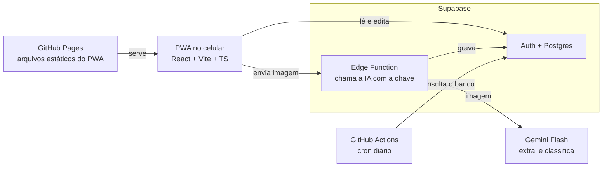

# App de Preços de Mercado — Requisitos

Atualizado em 31/10/2026.

## Visão geral

Um PWA que extrai os itens de cupons fiscais (NFC-e) a partir de imagens, guarda os preços e mostra quando um produto subiu, qual mercado compensa mais e como dois mercados se comparam.

**Problema:** no mercado não dá para saber se um produto subiu de preço, porque não há comparativo com as compras anteriores.

**Escopo inicial:** uso doméstico, uma casa, compras em Campina Grande (PB). A Paraíba é o estado de referência para o formato da NFC-e.

**Fora do escopo por enquanto:** fontes externas de preço, outros estados, uso por várias casas.

## Usuários e contexto de uso

Duas pessoas da mesma casa usam o app com os mesmos dados; não importa quem enviou cada cupom.

- **Frequência:** 3 a 4 cupons por mês (feira mensal e complementos).
- **Momento de uso:** em casa, depois da compra, enviando a imagem do cupom.
- **Mercados:** majoritariamente o Atacadão, mas varia entre mercados.
- **Consulta:** histórico de preços e comparação entre mercados, a qualquer momento.

## Requisitos funcionais do MVP

O MVP lê a imagem, guarda os preços e compara. A revisão dos dados extraídos acontece depois de salvar, não antes.

| ID | Requisito | Detalhe |
| --- | --- | --- |
| RF01 | Enviar imagem do cupom | Print da página da SEFAZ-PB gerada pelo QR ou foto do cupom físico. Antes do envio, um passo de recorte permite remover o CPF do consumidor. |
| RF02 | Extrair os dados por IA | Mercado (CNPJ, razão social, endereço), data e hora, chave de acesso, itens (código, descrição, quantidade, unidade, valor unitário, valor total), total dos produtos, desconto geral, total pago e forma de pagamento. |
| RF03 | Evitar cupom duplicado | A chave de acesso identifica a nota; um segundo envio da mesma nota é recusado. |
| RF04 | Cadastrar mercado pelo CNPJ | Na primeira compra o usuário dá um apelido (ex.: Atacadão Jardim Tavares). Cada filial é um mercado distinto. |
| RF05 | Classificar itens por IA | Cada item recebe uma classe que distingue tipo (arroz branco, integral, parboilizado) e uma categoria ampla: Não perecíveis, Laticínios e frios, Carnes (frango, porco, peixe, boi), Perecíveis (ovo, tapioca, panificados), Hortifruti, Bebidas, e Limpeza e higiene. |
| RF06 | Lembrar classificações | Uma correção feita pelo usuário vale para os próximos cupons com o mesmo item no mesmo mercado ou rede. |
| RF07 | Editar dados depois de salvar | Corrigir descrição, quantidade, preço, classe e categoria de qualquer item. |
| RF08 | Normalizar preço por kg ou litro | Itens a granel já vêm por kg. Para itens por unidade, o app pergunta o tamanho da embalagem na primeira vez e lembra; sem essa informação, não normaliza. |
| RF09 | Tabela de preços com filtros | Filtrar por item ou classe, mercado e período. |
| RF10 | Histórico de preço | Evolução do preço por classe e por produto, com destaque de alta ou baixa. Referência: mediana do preço normalizado da classe nos últimos 3 meses, considerando todos os mercados. Em alta: 20% ou mais acima da referência; em baixa: 20% ou mais abaixo. O limite é configurável no app (padrão 20%). Com menos de duas compras da classe, não marca nada. |
| RF11 | Comparar dois mercados | Mostra qual mercado compensa mais para fazer a feira ao longo do tempo. Lado a lado, para as classes compradas nos dois, usando o preço normalizado quando houver. |

## Requisitos funcionais pós-MVP

Estes entram depois que o fluxo principal estiver em uso.

| ID | Requisito | Detalhe |
| --- | --- | --- |
| RF12 | Notinha de descontos | Enviada junto com o cupom ou depois. O app vincula à compra pelo mercado, horário e itens, e grava o preço com desconto em cada item. Sem a notinha, a compra registra só o desconto geral. |
| RF13 | Entrada manual | Registrar compras sem cupom fiscal (ex.: frutas na quitanda), com local, data, itens e preços. Serve também para lançar o histórico dos últimos 3 meses, sem importação de planilha. |
| RF14 | Resumo de gastos | Total por mês, por categoria e por forma de pagamento, para alimentar a planilha de gastos mensal. |
| RF15 | Leitura pela URL do QR | Modo preciso: buscar os dados direto na SEFAZ-PB a partir da chave de acesso, sem erro de leitura de imagem. |

## Regras de negócio e o cupom da PB

O cupom de exemplo (Atacadão, 30/10/2026, 58 itens, R$ 813,15) mostra o que a extração precisa tratar.

- **Mercado ≠ nome na nota.** A nota traz a razão social (WMS Supermercados do Brasil), não a marca. O mercado é identificado pelo CNPJ completo; a filial está no sufixo (0667, o mesmo LJ:667 da notinha de descontos).
- **Código do item é interno e pode vir truncado.** No print, a coluna aparece cortada (AR04610 no cupom, 46105 na notinha). O código só identifica o produto dentro do mesmo mercado ou rede; entre mercados, quem liga os produtos é a classe.
- **Descrições abreviadas.** Ex.: RF.MIX C.GRANO CONG, LEITE PO ITAMBE INT. A classificação precisa lidar com abreviações.
- **Embalagem quase nunca aparece.** O peso de itens por unidade não vem na descrição, daí a pergunta do RF08.
- **Unidades variadas.** UND, KG, PCT, BDJ, MCO, PTE. Itens em KG têm quantidade fracionada e valor unitário já por kg.
- **Itens repetidos.** O mesmo produto pode aparecer em mais de uma linha (ex.: lombo suíno com pesos diferentes); cada linha é guardada, e o preço unitário é o que conta.
- **Desconto.** A NFC-e mostra só o desconto total. A notinha do Atacadão lista, por item, quantidade, preço normal e preço com desconto.
- **Preço de referência.** O preço comparado é o valor unitário efetivamente pago; quando há notinha, é o preço com desconto.

## Requisitos não funcionais

- **Custo zero.** Volume de 3 a 4 cupons por mês cabe em planos gratuitos de hospedagem, banco e IA.
- **PWA instalável.** Funciona no celular, com HTTPS e acesso à câmera e à galeria.
- **Dados compartilhados.** Os dois usuários veem os mesmos dados em qualquer dispositivo, o que exige um banco no servidor, não só armazenamento local.
- **Chave da IA protegida.** A chamada ao modelo passa por uma função no servidor; a chave nunca fica no código do front nem no repositório.
- **Privacidade.** O cupom traz o CPF do consumidor. O usuário recorta essa parte da imagem no próprio app antes de enviar (RF01), e o app não guarda o campo se ele aparecer, e no plano gratuito do Gemini o conteúdo enviado pode ser usado pelo Google para melhorar seus produtos ([fonte](https://yingtu.ai/en/blog/google-gemini-api-free-tier-limits-2026)).
- **Acesso restrito.** Só a casa acessa os dados, por uma única conta compartilhada.

## Arquitetura proposta

GitHub Pages sozinho não basta: ele hospeda arquivos estáticos, mas não guarda dados compartilhados entre dois celulares nem esconde a chave da IA. Por isso o PWA fica no Pages e o resto no Supabase.

O celular baixa o PWA do Pages, lê e edita os dados no Postgres e manda a imagem para a Edge Function, que chama o Gemini e grava o resultado.

| Peça | Escolha | Motivo |
| --- | --- | --- |
| Front | PWA em React (Vite + TypeScript) no GitHub Pages | Gratuito, HTTPS e deploy pelo próprio repositório |
| Banco e login | Supabase (Postgres + Auth) | Postgres com login e API prontos, no plano gratuito |
| IA | Gemini Flash via Edge Function | Plano gratuito sobra para 3 a 4 cupons por mês; a chave fica no servidor |
| Keep-alive | GitHub Actions com cron | O Supabase pausa projetos gratuitos com pouca atividade em 7 dias ([fonte](https://supabase.com/docs/guides/platform/free-project-pausing)) |

Com 3 a 4 envios por mês, o projeto seria pausado entre uma feira e outra sem o keep-alive. Um projeto pausado pode ser retomado pelo painel com os dados intactos, mas isso quebra o uso no dia a dia.

## Questões em aberto

Nenhuma no momento: as decisões do MVP estão tomadas.
